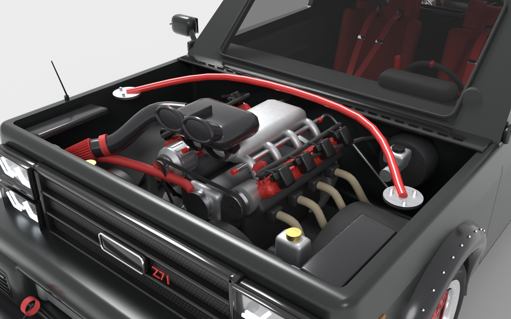
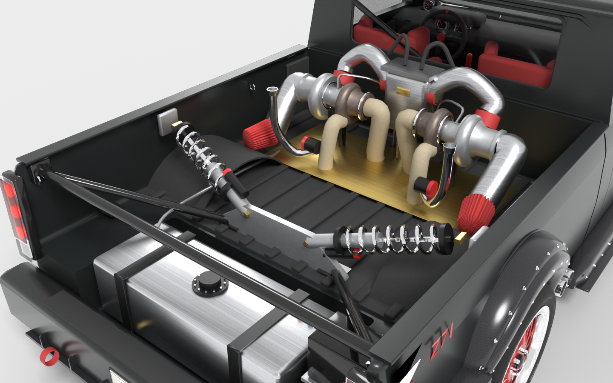
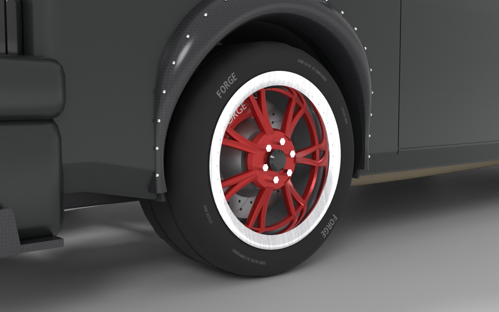
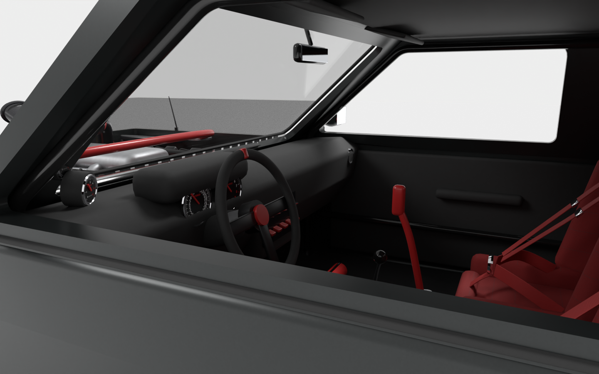

# AC Forge: '94 Silverado Z71 Twin Turbo

A high-detail **1994 Chevrolet Silverado Z71** short-bed regular cab for **Assetto Corsa**, built to real GMT400 dimensions. The truck is slammed on riveted carbon wide-body flares. It has an iron V8 under a hood with a cut-out for the carbon intake, and a **rear bed-mounted twin-turbo system** whose exhaust exits **through both sides of the box, just ahead of the rear wheels**.

Everything is generated from code. The 3D model comes from Blender scripts in `blender/forge/`, and the physics are plain-text `.ini` files. The build writes the game's own **`.kn5` model files** directly, so you don't need the AC Editor (ksEditor), and it zips the whole car folder for **Content Manager**.

| | |
|---|---|
|  |  |
|  |  |
|  |  |


## Install on PC (Assetto Corsa + Content Manager)

1. **Get the zip:** `dist/acf_blackout_pickup.zip` (25 MB) in this repo. It holds one folder, `acf_blackout_pickup`, with the four model files, data, skin and UI assets.
2. **Install it:** drag the zip onto the Content Manager window and accept the install prompt. To install by hand instead, unzip it so you get `assettocorsa\content\cars\acf_blackout_pickup`.
3. **Add the engine sound (required):** a car needs a sound folder (`sfx`), and the sound banks can't be generated here. In Content Manager, open **Content → Cars**, pick *Chevrolet Silverado Z71 1994 Twin Turbo*, and use its **Replace sound** action with a V8 donor car (a stock Kunos V8 such as the Corvette or Mustang). Do this before you drive, or the car may fail to load.
4. **Check it in the showroom:** use Content Manager's showroom (or Quick Drive → pick the car). Look for:
   - wheels sitting in the arches (adjust `GRAPHICS_OFFSET` in `data/car.ini` if not),
   - the driver camera in the left seat (`DRIVEREYES` in `data/car.ini`),
   - lights, steering wheel and wheel blur working.
5. **Drive it.** The physics follow Kunos formats but were never driven in game, so expect to tune `tyres.ini`, `suspensions.ini` and `drivetrain.ini`. Content Manager's data editor and its error log will tell you about any missing key.

Not included: sound banks (step 3), a driver model, and animated doors or wipers.

## Vertex budget

| | In-game vertices | Triangles | File |
|---|---|---|---|
| LOD A (full detail, with the low-res interior) | 198,213 | 208,600 | `acf_blackout_pickup.kn5` |
| LOD B | 84,100 | 84,700 | `acf_blackout_pickup_B.kn5` |
| LOD C | 41,500 | 36,500 | `acf_blackout_pickup_C.kn5` |
| LOD D | 20,500 | 16,800 | `acf_blackout_pickup_D.kn5` |

- **Counted the way the game counts:** a vertex is one unique position, normal and UV, which is what the `.kn5` file stores.
- **Total budget: 200,000.** `VERTEX_BUDGET` in `blender/forge/export.py` caps LOD A. Fasteners, small engine and turbo parts, interior and text are trimmed to fit. Body panels, the hood, flares and wide-body parts, tyres, rotors, glass and lights are never touched. Raise the constant to keep more detail.
- **Per-mesh limit: 65,535.** This is the `.kn5` format's own limit (16-bit indices), so it can't be raised. The largest mesh here has 17,684 vertices, and the exporter splits any mesh that gets near the limit.

## Second car: your sculpted model (`chevy_z71`)

`content/cars/chevy_z71` (zip: `dist/chevy_z71.zip`) is the sculpted widebody Silverado you supplied as a `.kn5`, turned into a complete car for Content Manager. Install it the same way as above, including **Replace sound**.

- **Model:** your geometry is kept as delivered (same mesh, normals, UVs and wheel pivots). The source is `blender/user_model/source/chevy_z71.kn5`.
- **Vertex limit:** the full-detail model was 331,479 in-game vertices. To fit the 200,000 limit, the body was collapse-decimated to 198,679 and the wheels were left untouched. Raise `VERTEX_BUDGET` in `blender/forge/export.py` to keep more detail. Lower-detail versions B, C and D were added for distance.
- **Shading:** `Silver_Paint`, `Tire_Rubber` and `Wheel_Alloy` now have paint, rubber and metal values instead of flat matte.
- **Skins:** *Silver Clay* (your colour) and *Blackout*. A skin only needs its own `Silver_Paint.png`.
- **Physics:** fitted to the model: 3.09 m wheelbase, 1.83 m track, 0.465 m tyres on 0.34 m rims. The final drive is raised to 4.89 so road speeds per gear match the bigger tyres. Collision boxes, driver camera and shadows match the body.
- **Missing parts:** the body is one joined mesh, so it has no separate glass, lights, interior or steering wheel. `lights.ini` is therefore empty.

Rebuild it with:

```bash
python blender/user_model/build_chevy_z71.py --render
```

## Real-world specs

The layout follows a 1994 Chevrolet C/K1500 (GMT400) **regular cab, short (6.5 ft) bed**. The wide-body kit sits on top of it.

| | Real truck | Model |
|---|---|---|
| Wheelbase | 117.5 in (2.985 m) | 117.3 in (2.98 m) |
| Body width (stock panels) | 76.8 in (1.95 m) | 78.4 in (1.99 m), includes the barrel curvature of the panels |
| Width over the wide-body flares | n/a | 86.9 in (2.21 m), about 5 in extra per side |
| Track (wide-body) | ~64 in (1.63 m) stock | 72.4 in (1.84 m), tyres flush with the flares |
| Cab length (firewall to back) | roughly 50 in | 52 in (1.32 m) |
| Door length | roughly 42 in | 43 in (1.10 m) |
| Box (bed) inside length | 78 in (1.98 m) | 78 in (1.98 m) |
| Overall length | ~194 in (4.93 m) with bumpers | 4.70 m sheet metal, 5.33 m with bumpers and splitter |
| Tyres | n/a | 285/35 R20 front, 335/30 R20 rear on 20" rims (radius 0.355 m) |
| Height | 70.3 in (1.79 m) stock | 63.0 in (1.60 m), lowered about 7 in |

The real-truck figures are approximate factory numbers from memory, so check them against a factory spec sheet if you need exact values. The cab and bed were out of proportion in the first version (the cab about 17 in too long, the bed about 20 in too short). That is fixed.

## What's modelled

- **Curved body panels:** a lofted GMT400 shell, built from about 130 cross-sections of about 90 points each, then boolean-cut and bevelled.
  - Barrel-shaped door and bedside panels with the shoulder crease, cab tumblehome, crowned roof and fender tops.
  - Door shut lines, a separate door-glass pane, flush handle recesses, fuel door, rounded bed rail caps with stake pockets, and wheel tubs.
  - Hood with a crown, a front roll-off and two character lines. A rounded cut-out with a brushed trim ring lets the carbon airbox stand through it, and it has drag-style hood pins.
  - Open bed with no tailgate, and a tube truss across the back.
- **Wide-body kit:**
  - Bolt-on carbon over-fenders on all four wheels. They have a stepped lip, hex bolts on two rows, and a rubber seal around the edge.
  - Carbon side skirts from the front flare to just ahead of the exhaust exits, with a splitter blade and a row of bolts.
  - Bolted carbon flare extensions that carry the wide-body line from the wheels into both bumpers.
  - A 1.84 m track, so the wheels sit flush with the flares.
  - Carbon front splitter with endplates, canards and support rods, and a rear diffuser.
- **Side-exit exhaust:** twin tips come out low through **both sides of the box**, at rocker level just ahead of the rear flares, and stand proud of the panel. Each exit has a cut in the panel and a machined trim ring with screws. The pipes run from the bed-mounted turbos to the exits.
- **Front:** quad LED headlamps, a two-tier honeycomb grille with a centre band carrying a red-outlined bowtie and a red Z71, slatted bumper intakes, intercooler with end tanks, a tow strap, mirrors, wipers and a cowl.
- **Engine bay:**
  - V8 with finned red valve covers, coil packs, intake runners and twin throttle bodies under a carbon twin-oval airbox.
  - Carbon intake tube with red bands to a cone filter, fuel rails with braided lines, belt drive, radiator with fans, wrapped headers, a red strut brace, booster and master cylinder.
- **Bed twin-turbo kit:**
  - Two turbos with snail-shell housings and visible compressor blades, mounted right behind the cab.
  - Silver charge pipes into a centre plenum, red cone filters, wastegates with screamer pipes, a gold heat shield.
  - Diagonal inboard coilovers on an aluminium A-bracket, a strapped aluminium fuel cell low in the open back, and a battery.
- **Wheels:**
  - 20" red rims with 20 crossing thin spokes (the multi-spoke look of the drawings), polished riveted lips and hex lug nuts.
  - Semi-slick tyres with sidewall lettering, drilled two-piece rotors and 6-piston calipers.
  - Blurred rim discs for speed.
- **Interior:** red buckets with 5-point harnesses, roll cage, dash with tach, speedo and boost gauges, switch panel, pedals, shifter, handbrake, a steering wheel that turns in game, door cards, mirror and fire extinguisher.

## Files

```
blender/build_truck.py            entry point
blender/forge/                    geometry toolkit + one module per area (body, front_rear, engine, bed,
                                  interior, wheels, chassis), materials/textures, LOD + FBX export, renders
blender/out/
  acf_blackout_pickup.fbx           LOD A, full detail (for ksEditor / Blender)
  acf_blackout_pickup_B/C/D.fbx     distance LODs
  acf_blackout_pickup.blend         editable Blender scene
  acf_blackout_pickup.glb           quick look in any 3D viewer
  texture/*.png                     textures referenced by the FBX files
  preview_*.png                     renders
dist/acf_blackout_pickup.zip      ready-to-install car for Content Manager
content/cars/acf_blackout_pickup/
  acf_blackout_pickup*.kn5          the four game models (LOD A-D)
  data/      physics, lights.ini, lods.ini, blurred_objects.ini, setup.ini ...
  ui/        name, specs and curves for the car menu
  skins/     default skin
```

## Rebuild the model

This needs Blender 4.2 or newer (tested on 5.1). The `bpy` module plus `pillow` and `numpy` also work.

```bash
blender -b -P blender/build_truck.py -- --render
```

Without `--render` the build takes under a minute and still writes the `.kn5` files, the car folder and the zip. The renders take about 20 minutes on a CPU.

Options:
- `--quick` renders fast low-sample previews.
- `--views side,front_quarter` renders only some views.
- `--no-lods` skips the distance versions.
- `--only body,engine` builds only some parts, for testing.

The headlight style is the constant `LAMP_STYLE` in `blender/forge/front_rear.py`:
- `"angled"` gives the angled LED strips from the photo-style reference.
- `"bracket"` gives the square brackets from the drawn concept art.

## Making models for other tools

The build also writes the FBX files (`acf_blackout_pickup.fbx` and `_B/_C/_D.fbx`), a `.blend` and a `.glb`. You only need them if you want to edit the model in ksEditor or Blender. In ksEditor, use the shader names from `content/cars/acf_blackout_pickup/` as a guide: `ksPerPixel` for everything, and `ksPerPixelAlpha` (alpha blend on, depth read-only) for `Glass`, `Lens_*` and `Rim_Blur`.

### Node names AC uses (already set in the model)

| Node | Behaviour |
|---|---|
| `WHEEL_LF/RF/LR/RR` | tyres and rims; rotate and steer |
| `DISC_*` | rotors; rotate and glow |
| `SUSP_*` | calipers and uprights; steer, don't rotate |
| `STEER_HR` / `STEER_LR` | steering wheel |
| `COCKPIT_HR` / `COCKPIT_LR` | interior, high-res and low-res |
| `RIM_BLUR_*` | blurred rims (`data/blurred_objects.ini`) |
| `LIGHT_HEAD_L/R`, `LIGHT_TAIL_L/R`, `LIGHT_BRAKE3`, `LIGHT_MARKER_F/R` | lights (`data/lights.ini`) |

### How the `.kn5` is written

`blender/forge/kn5.py` converts Blender space (right-handed, Z up, front +Y) to Assetto Corsa space (left-handed, Y up, front +Z, left side −X), reverses the triangle winding, flips V, and writes the file layout described at the top of that module. It was checked by reading the files back with a strict parser: no stray bytes, all indices in range, every texture embedded, and 99.99% of triangles wind consistently with their normals.

## Known limits

- **Not tested in game:** I have no Windows, Assetto Corsa or Content Manager here. The `.kn5` files were checked by reading them back and by comparing the layout against public documentation and example cars, but nobody has loaded this truck yet. If Content Manager or the game reports a problem, send me the message or the log.
- **Sound:** you must add it with Content Manager's Replace sound (see above).
- **Physics:** the data follows Kunos formats but has never been driven. Expect to tune `tyres.ini` and `suspensions.ini`.
- **Missing parts:** there's no driver model, and the doors and wipers aren't animated.
- **`setup.ini`:** the garage setup sections (pressures, camber, toe, fuel, brake bias and power) are modelled on Kunos examples, but the game hasn't read them yet.
- **Textures:** they are generated colours, patterns and lettering, not photo textures.
