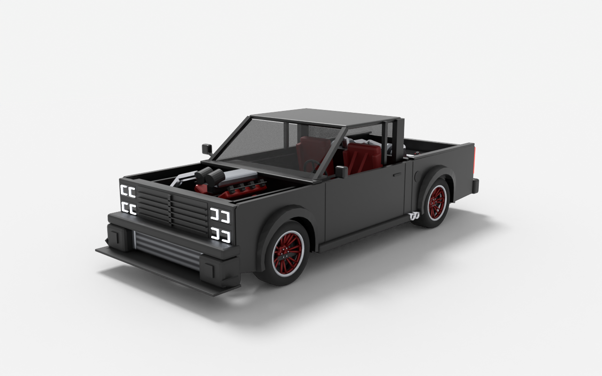
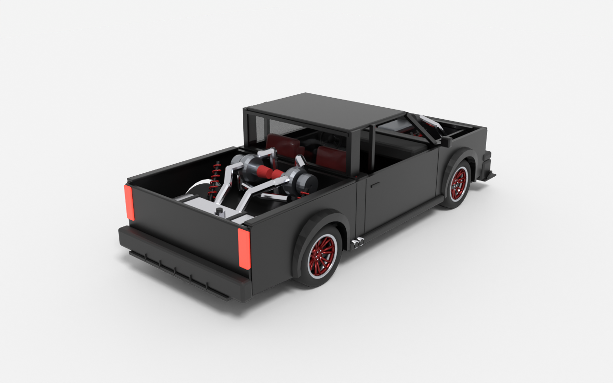
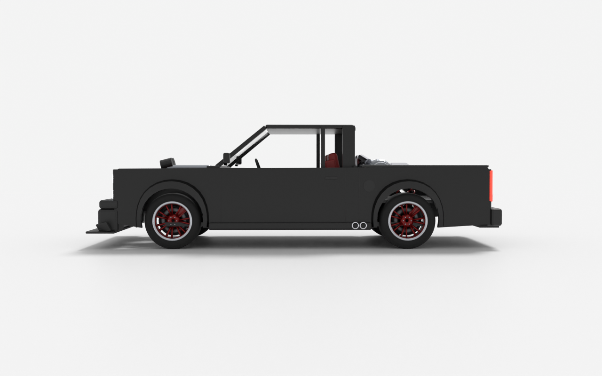

# AC Forge: Blackout Pickup

A slammed, wide-body, twin-turbo regular-cab pickup for **Assetto Corsa**, built from the concept art. Everything is generated from code: the 3D model comes from a Blender script, and the physics are plain-text `.ini` files.

| | |
|---|---|
|  |  |



## What's here

```
blender/build_truck.py          builds the whole 3D model (re-run after any change)
blender/out/                    generated output
  acf_blackout_pickup.fbx         import this into the AC Editor (ksEditor) to make the .kn5
  acf_blackout_pickup.blend       editable Blender scene
  acf_blackout_pickup.glb         quick look in any 3D viewer
  textures/*.png                  one texture per material (referenced by the FBX)
  preview_*.png                   renders
content/cars/acf_blackout_pickup/
  data/                           physics: engine, turbos, gearbox, suspension, tyres, aero, lights...
  ui/ui_car.json                  name, specs, torque/power curves for the car menu
  skins/blackout_red/             default skin
```

**Spec:** iron-block V8 with twin turbos, about 900 hp and 1100 Nm at full boost. 6-speed manual, RWD, clutch-type LSD set up for drifting. 1580 kg, 55/45 weight split. Double wishbones all round. 285/335 semi-slicks on 20" rims.

## Rebuild the model

The script needs Blender 4.2 or newer. It was tested with Blender 5.1.

```bash
blender -b -P blender/build_truck.py -- --render
```

Leave out `--render` to skip the preview renders, which take a few minutes on a CPU. Without Blender installed, `pip install bpy` and `python blender/build_truck.py` work too.

## Getting it into the game

1. **Make the .kn5:** open the **AC Editor** (`assettocorsa/sdk/editor/ksEditor.exe`, from Steam Tools). Load `acf_blackout_pickup.fbx`, keeping `textures/` next to it.
2. **Set shaders:** use the table below for each material, then do *File → Save kn5* as `content/cars/acf_blackout_pickup/acf_blackout_pickup.kn5`.
3. **Copy the car folder:** copy `content/cars/acf_blackout_pickup` into your game's `content/cars/`.
4. **Add sound:** in **Content Manager**, open the car and use *Sound → Replace sound* with any V8 car as the donor (for example, a Kunos Mustang or Corvette). That creates `sfx/`. Without it, the car is silent or won't load.
5. **Line up the wheels:** open the car in CM's **Showroom / Custom Showroom** to check that the wheels sit in the arches. If they don't, tweak `GRAPHICS_OFFSET` in `data/car.ini`.
6. **Optional, pack the data:** in Content Manager, use *Car → Pack data* to turn `data/` into `data.acd`. Only do this once the physics are final.

### Shaders for ksEditor

| Material | Shader | Notes |
|---|---|---|
| Paint_Black | `ksPerPixelMultiMap` (or `ksPerPixel`) | the skin repaints `Paint_Black.png` |
| Trim_Black, Grille_Black, Interior_Black, Engine_Dark, Rubber_Hose, Lamp_Glass | `ksPerPixel` | |
| Rim_Red, Rim_Lip_Silver, Metal_Polished, Metal_Alu, Intercooler, Brake_Disc | `ksPerPixel` | raise `ksSpecular`/`ksSpecularEXP` for shine |
| Caliper_Red, ValveCover_Red, Seat_Red, Strap_Red, Filter_Red | `ksPerPixel` | |
| Tyre | `ksTyres` (or `ksPerPixel`) | |
| Glass | `ksPerPixelAlpha` | Alpha blend **on**, depth mode **read-only** |
| Light_Head, Light_Tail | `ksPerPixel` | `data/lights.ini` makes them glow when lights are on or when braking |

### Node names AC uses (already set in the model)

| Node | Behaviour |
|---|---|
| `WHEEL_LF/RF/LR/RR` | rims and tyres; rotate and steer |
| `DISC_*` | brake discs; rotate and glow |
| `SUSP_*` | calipers; steer, don't rotate |
| `STEER_HR` | steering wheel |
| `COCKPIT_HR` | interior |
| `LIGHT_HEAD_L/R`, `LIGHT_TAIL_L/R` | light meshes |

## Known limits / next steps

- **Detail level:** this is a clean low-poly game asset made from simple shapes, not a sculpted showroom model. The body panels are flat.
- **Badges:** no logos are modelled. Add your own decals in a skin's `Paint_Black` texture.
- **Missing parts:** there's no LOD, driver model, or animated doors or wipers yet. There's also no blurred-wheel mesh.
- **Untested physics:** the files follow Kunos formats but haven't been driven in-game yet. Expect to tune `tyres.ini` and `suspensions.ini`. Content Manager reports any missing key on load.
